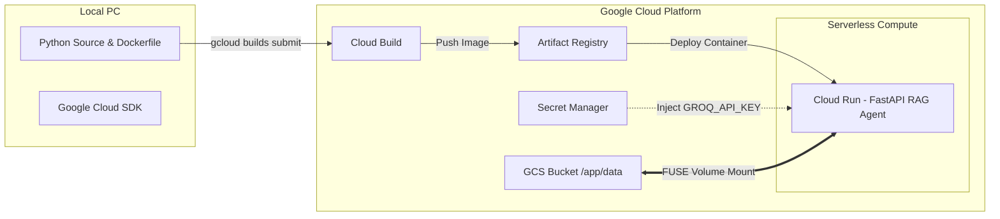

# Requirements

### Overview & Goals
The objective is to push the local Python codebase (`hunterai-main`) from the local PC workstation to Google Cloud with maximal operational efficiency, minimal maintenance friction, and robust scalability. By utilizing Google Cloud Run paired with Artifact Registry and Google Cloud Storage (GCS), the application achieves fully managed serverless hosting, automatic HTTPS termination, scale-to-zero cost optimization, and secure secrets handling.

### Scope
- **In Scope:**
  - Authenticating and configuring the local Google Cloud SDK (`gcloud`).
  - Building and pushing the container image to Google Artifact Registry using Google Cloud Build.
  - Setting up Google Secret Manager for secure storage of API credentials (`GROQ_API_KEY`).
  - Deploying the FastAPI RAG service to Google Cloud Run.
  - Configuring persistent storage for raw documents and vector indices using Cloud Storage FUSE volume mounts.
  - Verifying operational health, log streams, and API responsiveness.
- **Out of Scope:**
  - Migrating to custom Kubernetes clusters (GKE) or non-serverless dedicated VMs.
  - Custom domain DNS mapping (can be linked later via Cloud Run Domain Mapping).

### User Stories
- As a **Developer**, I want to push my local Python code directly into Google Cloud without manual server provisioning so that I maximize deployment speed and avoid runtime environment mismatches.
- As an **Operator**, I want credentials stored securely in Secret Manager and data persisted in Cloud Storage so that application instances remain stateless and secure.
- As a **User**, I want the deployed API to answer questions reliably with minimal latency and high availability.

### Functional Requirements
- **FR-1:** All required files (`api_fastapi.py`, `config.py`, `rag/`, `services/`, `static/`, `Dockerfile`, `requirements.txt`) must be packaged and built into an OCI-compliant container image.
- **FR-2:** The deployment pipeline must prevent leaking sensitive files (`.env`, local venvs) into the cloud build.
- **FR-3:** Secrets (`GROQ_API_KEY`) must be dynamically injected into Cloud Run at runtime from Secret Manager.
- **FR-4:** The service must expose HTTP endpoints (`/api/health`, `/api/ask`, `/api/reindex`, `/api/documents`) accessible via managed HTTPS.

### Non-Functional Requirements
- **Security:** Zero plaintext API keys stored in container images or source repositories.
- **Cost Efficiency:** Serverless scale-to-zero when idle, spinning up instances on demand.
- **Reliability:** Built-in readiness and liveness health checks via FastAPI endpoint `/api/health`.

# Technical Design

### Current Implementation & Local State
The local project at `C:\Users\nachi\OneDrive\Desktop\hunterai-main` contains:
- `Dockerfile`: Debian-based Python 3.12 image configured with Uvicorn entrypoint on port 5000.
- `api_fastapi.py`: FastAPI server serving static UI and JSON API endpoints (`/api/ask`, `/api/health`, `/api/reindex`, `/api/documents`).
- `config.py`: Environment configuration class parsing `RAG_HOST`, `RAG_PORT`, `RAG_DEBUG`, `RAG_INDEX_PATH`.
- `rag/`: Vector search, text chunking, local sentence-transformers embedder, and agent loop.
- `.dockerignore`: Configured to exclude `.env`, `venv/`, and `__pycache__/`.

### Key Decisions
- **Cloud Run as Target Platform:** Yields the highest utility-to-overhead ratio. Eliminates VM patching, cluster maintenance, and idle compute expenses while supporting standard Docker containers.
- **Cloud Build for Remote Compilation:** Avoids local Docker daemon dependency on Windows; source is zipped and compiled directly inside Google Cloud infrastructure.
- **Secret Manager for Credential Isolation:** Decouples secrets from runtime images and environment definition files, ensuring compliance and security.
- **GCS FUSE Volume Mounting:** Resolves container ephemerality by mapping a GCS bucket directly to `/app/data`, ensuring document storage and vector store files persist across container restarts.

### Architecture Diagram


### Step-by-Step Implementation Guide

#### 1. Google Cloud SDK Initialization
Install Google Cloud SDK on your PC and initialize authentication:
```powershell

# Authenticate account

gcloud auth login
gcloud auth application-default login

# Configure project

gcloud config set project YOUR_PROJECT_ID
gcloud config set run/region us-central1
```

#### 2. Enable Required Cloud Services
```powershell
gcloud services enable `
    run.googleapis.com `
    artifactregistry.googleapis.com `
    cloudbuild.googleapis.com `
    secretmanager.googleapis.com `
    storage.googleapis.com
```

#### 3. Provision Cloud Infrastructure Components
```powershell

# Create Artifact Registry for Docker images

gcloud artifacts repositories create rag-agent-repo `
    --repository-format=docker `
    --location=us-central1 `
    --description="Repository for RAG Agent container images"

# Create Secret in Secret Manager for Groq API Key

Write-Output -NoNewline "your_groq_api_key_here" | gcloud secrets create groq-api-key --data-file=-

# Create Cloud Storage Bucket for persistent data

gcloud storage buckets create gs://YOUR_PROJECT_ID-rag-data --location=us-central1
```

#### 4. Build and Push Source Code
From the project root directory (`C:\Users\nachi\OneDrive\Desktop\hunterai-main`):
```powershell

# Submit local directory to Cloud Build and tag into Artifact Registry

gcloud builds submit --tag us-central1-docker.pkg.dev/YOUR_PROJECT_ID/rag-agent-repo/rag-agent:v1 .
```

#### 5. Deploy to Google Cloud Run
```powershell
gcloud run deploy rag-agent `
    --image us-central1-docker.pkg.dev/YOUR_PROJECT_ID/rag-agent-repo/rag-agent:v1 `
    --platform managed `
    --region us-central1 `
    --allow-unauthenticated `
    --port 5000 `
    --memory 2Gi `
    --cpu 2 `
    --set-env-vars="RAG_HOST=0.0.0.0,RAG_PORT=5000,RAG_DEBUG=false,RAG_INDEX_PATH=/app/data/index/store.pkl" `
    --set-secrets="GROQ_API_KEY=groq-api-key:latest" `
    --add-volume=name=rag-storage,type=cloud-storage,bucket=YOUR_PROJECT_ID-rag-data `
    --add-volume-mount=volume=rag-storage,mount-path=/app/data
```

### Risks & Mitigations
- **Risk:** Sensitive credentials pushed inside the build image.
  - **Mitigation:** Ensure `.dockerignore` contains `.env`, and inject API keys exclusively via Secret Manager.
- **Risk:** Ephemeral disk wipes vector index on container restart.
  - **Mitigation:** Mount Google Cloud Storage bucket to `/app/data` using Cloud Run volume mount.
- **Risk:** Cold start latency due to embedding model loading.
  - **Mitigation:** Lazy-load embedder and agent (already implemented in `api_fastapi.py`), or set `--min-instances 1` in Cloud Run if zero-latency is required.

# Testing & Verification

### Validation Approach
Verification confirms that the local files have successfully compiled into the cloud container, secrets and volumes are correctly bound, and the HTTP service is operational.

### Key Scenarios
- **Service Availability Check:**
  - Execute `GET https://<CLOUD_RUN_URL>/api/health`
  - Expected: HTTP 200 with JSON payload containing `status: "ok"`, `app_name: "Hunter AI RAG"`.
- **Knowledge Ingestion & Indexing:**
  - Execute `POST https://<CLOUD_RUN_URL>/api/reindex`
  - Expected: HTTP 200 with total document and chunk count persisted to `/app/data/index/store.pkl`.
- **Agent Question Answering:**
  - Execute `POST https://<CLOUD_RUN_URL>/api/ask` with payload `{"question": "What is the deployment procedure?"}`
  - Expected: HTTP 200 containing generated answer grounded in the indexed corpus.

### Edge Cases & Diagnostic Checks
- **Cloud Run Log Inspection:**
  - Run `gcloud run services logs read rag-agent --region us-central1 --limit 50` to inspect startup traces and model load timing.
- **FUSE Mount Permissiveness:**
  - Confirm Cloud Run service account has `roles/storage.objectAdmin` on the target storage bucket.

# Delivery Steps

### * Step 1: Local Environment Preparation and GCP Authentication
Local environment is prepared and gcloud CLI is authenticated to the target GCP project.

- Verify local project files (`api_fastapi.py`, `config.py`, `Dockerfile`, `requirements.txt`, `.dockerignore`).
- Install and configure Google Cloud CLI (`gcloud`) on the local workstation.
- Run `gcloud auth login` and `gcloud auth application-default login` for authentication.
- Set active GCP project ID and default deployment region (`us-central1`).
- Enable necessary GCP APIs (`run.googleapis.com`, `artifactregistry.googleapis.com`, `cloudbuild.googleapis.com`, `secretmanager.googleapis.com`).

###   Step 2: Artifact Registry and Secret Manager Provisioning
Secure secret storage and container registry repository are initialized in GCP.

- Create an Artifact Registry Docker repository (`rag-agent-repo`) in the selected region.
- Configure local Docker / gcloud credential helper for Artifact Registry authentication.
- Create a secret in Google Secret Manager for sensitive environment variables such as `GROQ_API_KEY`.
- Assign Secret Accessor IAM roles to the default Cloud Run service account.

###   Step 3: Container Build and Push to Artifact Registry
Container image is compiled from local files and pushed to Google Artifact Registry.

- Ensure `.dockerignore` excludes unnecessary files (`.env`, `venv/`, `__pycache__/`, `tests/`).
- Trigger `gcloud builds submit` from the project root (`C:\Users\nachi\OneDrive\Desktop\hunterai-main`) to build the container remotely via Cloud Build.
- Tag and store the resulting image in Artifact Registry under `us-central1-docker.pkg.dev/PROJECT_ID/rag-agent-repo/rag-agent:v1`.
- Verify the container build logs for clean dependency installation and layer caching.

###   Step 4: Cloud Run Service Deployment and Storage Binding
FastAPI RAG application is running on Cloud Run with persistent storage integration.

- Deploy container to Google Cloud Run with appropriate memory (2Gi) and CPU (2 vCPU) allocations.
- Bind `GROQ_API_KEY` from Google Secret Manager directly into the runtime environment.
- Configure runtime environment variables (`RAG_HOST=0.0.0.0`, `RAG_PORT=5000`, `RAG_DEBUG=false`, `RAG_INDEX_PATH=/app/data/index/store.pkl`).
- Create and attach a Google Cloud Storage bucket via Cloud Run Volume Mount (Cloud Storage FUSE) to `/app/data` for persistent documents and vector store indexes.

###   Step 5: Post-Deployment Validation and Smoke Testing
Deployed Cloud Run service is active, responding to health checks, and processing RAG queries.

- Verify service readiness using the public Cloud Run URL at `GET /api/health`.
- Test document indexing via `POST /api/reindex`.
- Test query resolution and web search fallback via `POST /api/ask`.
- Inspect Cloud Logging streams to confirm error-free execution and monitor inference latency.